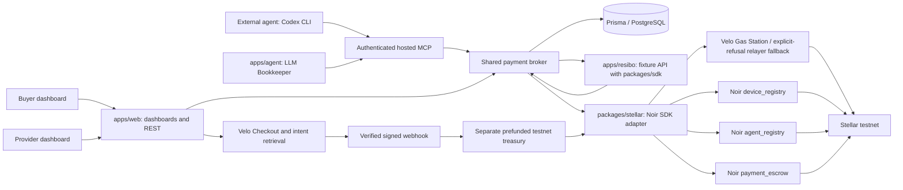
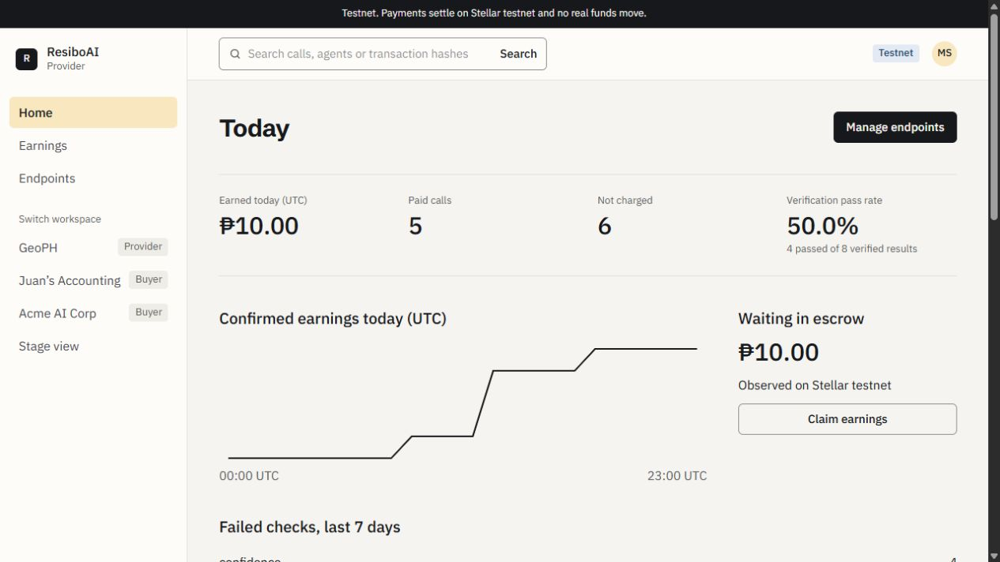
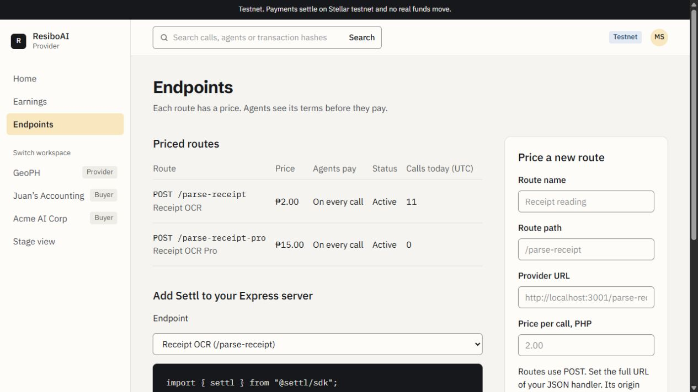
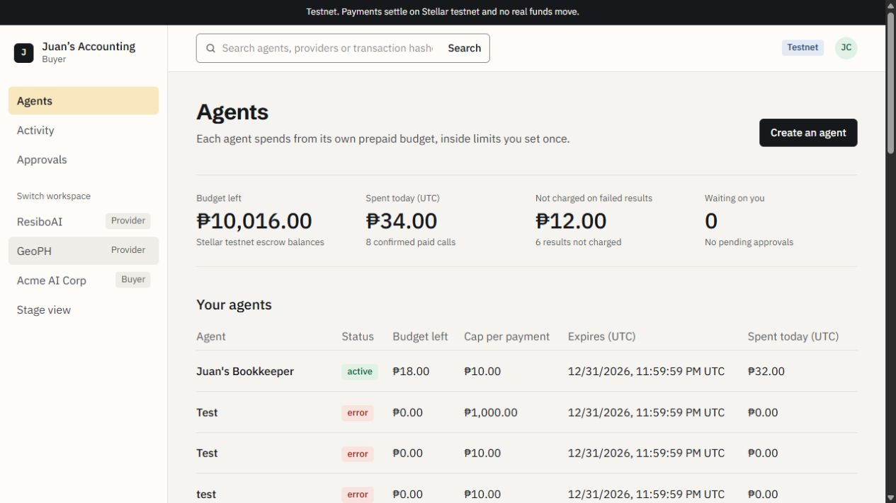
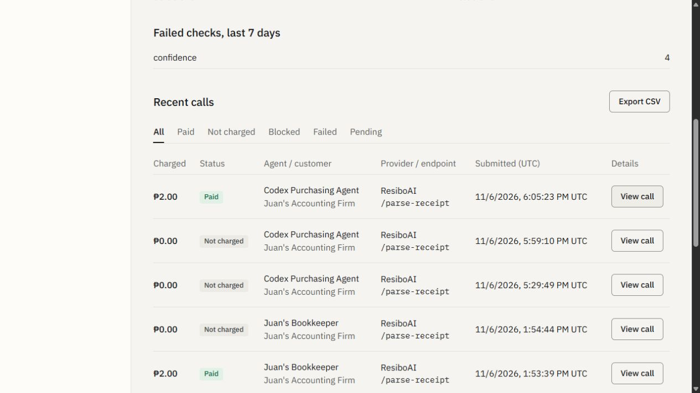

# Settl.ai

Settl lets a company's AI agent buy the APIs it needs from a prepaid budget, with spending controls and payment receipts on Stellar testnet.

**Live website:** https://settl-ai-pi.vercel.app

**Demo video (2 min):** Not recorded yet. Required before submission.

**Team:** Miggy Rivera (Discord: `_ra1ve`)

**Public monorepo:** https://github.com/migsrvr/settl.ai

## Problem

Companies want agents to use paid tools without handing them an unrestricted wallet or approving every small purchase. API providers need a way to quote a price, collect payment and prove which request earned it. Both sides need a record that distinguishes a confirmed charge from a refused or unresolved request.

## Solution

Settl is a payment gateway for API providers and AI agents. A provider registers a priced endpoint and adds the Express middleware. A buyer creates an agent, funds its escrow and sets its spending rules. The agent connects through REST or hosted MCP, discovers a service and requests the purchase. Settl checks policy, coordinates Noir authorization and the provider request, and records the receipt.

The implementation includes provider/buyer dashboards, six authenticated MCP tools, a provider SDK, human approvals, Velo top-ups, claims and automation handlers. External clients such as Codex CLI can use the hosted MCP. The separate Bookkeeper CLI uses an LLM to request tools.

**Current demo:** Receipt OCR costs **PHP 2 per call**, including blurry fixtures. Pro costs PHP 15 and GeoPH costs PHP 8. These are demo products with fixture outputs, not a production OCR service. Optional **Settl on Result** products charge only when agreed checks pass. The MVP uses custodial testnet wallets and native test XLM; peso amounts use a configured demo rate. Demo workspace selection is not production authentication.

## How the agentic payment works

1. **The buyer sets the budget.** Noir holds the device identity, agent policy and funded escrow. It enforces the asset, per-payment cap and expiry. Settl additionally checks allowed providers, daily spending and the human approval threshold.
2. **The agent chooses a tool.** It reads `settl_get_budget` and `settl_list_services` for its task. These reads are free; `settl_quote` records terms without charging.
3. **The agent requests a purchase.** For example, `settl_call` with `serviceId: "resibo_parse"`, `input: {"fixture":"clean"}` and `maxPricePhp: "10.00"` requests ResiboAI's PHP 2 service. The bearer key establishes the server-side agent identity.
4. **Settl applies policy.** A PHP 15 Pro request against a PHP 10 maximum returns `declined / over_max_price` before payment. GeoPH's PHP 8 price exceeds the example PHP 5 auto-approval threshold, so the buyer must approve it. The agent can then resume the same request using that approval ID.
5. **The broker authorizes and calls the provider.** In per-call mode it signs using the stored constrained agent key, prepares the Noir `authorize` operation through the SDK and waits for confirmation before invoking the provider. Value moves from available escrow to the provider's pending balance. A later provider failure does not reverse a confirmed usage charge.
6. **Both sides receive a record.** Confirmed charges include a receipt and transaction hash. Unknown/pending submissions stay unresolved and block replacement payments. The agent's narrative is not payment evidence.
7. **The provider claims earnings.** A separate Noir `claim` moves pending earnings to the merchant wallet. Authorization and payout are different transactions.

For an explicitly configured outcome product, Settl reserves the amount **off-chain**, calls the provider and runs the agreed deterministic checks. Passing checks trigger authorization; failures release the hold without payment. Current OCR defaults to per-call billing: a blurry sample still pays the API fee. The Bookkeeper refuses to create a business expense from low-confidence receipt data.

Use the [provider-to-Codex walkthrough](https://github.com/migsrvr/settl.ai/blob/master/docs/CODEX_MCP_LIVE_DEMO.md) for the external-agent demo. The [one-terminal rehearsal](https://github.com/migsrvr/settl.ai/blob/master/docs/LIVE_DEMO_GUIDE.md) is a separate deterministic driver. `/stage` is a scripted presentation fallback, not settlement evidence.

## Architecture



Settl connects Noir and Velo in application code. Checkout confirmation does **not** directly deposit into Noir escrow: Settl verifies the signed event, independently retrieves the stored intent, matches amount/receiver, then funds escrow from its treasury. Durable records and locks preserve operation identity across retries and uncertain submissions.

## Noir integration

- **Noir SDK version:** `@noirx402/agent-sdk` **0.3.0**, with Stellar SDK **17.0.0** and the root npm peer override. See the [manifest](https://github.com/migsrvr/settl.ai/blob/master/packages/stellar/package.json) and [adapter guide](https://github.com/migsrvr/settl.ai/blob/master/packages/stellar/README.md).
- **Contracts called:** all three deployed handbook testnet contracts. Explicit handbook IDs override the SDK's packaged defaults.

| Contract | Role | Deployed testnet ID |
| --- | --- | --- |
| `device_registry` | Owner/device/agent identity | `CAC4KOLHDLDYDWBOKXNKRN5KVHO56PLOIFXDLTBUWGVN6GVDEB7FQHU5` |
| `agent_registry` | Asset, per-payment cap, expiry | `CCMZDSPTLX7IIJWCYEUM5DJUHOSOYSTHGK777S2TXZWEMC5ZZGPJ3EBV` |
| `payment_escrow` | Funding, authorization, claims | `CC7EAW5FNJEDBS7THM5IT6XIOHO4AOYMLXT3KSZ3HWUIKEACTW7E5BFS` |

- **SDK methods used, with source links:**

| SDK methods / adapter operations | Real source |
| --- | --- |
| `PreparedNoirClient extends NoirAgentClient`; SDK `toCall(source, op)` encodes the operation; Stellar SDK 17 prepares the envelope | [rpc.ts, line 1](https://github.com/migsrvr/settl.ai/blob/master/packages/stellar/src/rpc.ts#L1) |
| `sdk.prepare`, source validation, signing and submission | [noir.ts, line 44](https://github.com/migsrvr/settl.ai/blob/master/packages/stellar/src/noir.ts#L44) |
| `registerDevice`, `registerAgent`, `fundEscrow` operations | [noir.ts, line 56](https://github.com/migsrvr/settl.ai/blob/master/packages/stellar/src/noir.ts#L56) |
| `authorize`, `claim` operations | [noir.ts, line 70](https://github.com/migsrvr/settl.ai/blob/master/packages/stellar/src/noir.ts#L70) |
| SDK reads: `getEscrowBalance`, `getPendingBalance`, `getEscrowToken`, `getPolicy`, `getDeviceOwner` | [noir.ts, line 78](https://github.com/migsrvr/settl.ai/blob/master/packages/stellar/src/noir.ts#L78) |
| `revokeAgent`, `sweepOnRevoke`, `revokeDevice` operations | [noir.ts, line 89](https://github.com/migsrvr/settl.ai/blob/master/packages/stellar/src/noir.ts#L89) |
| Testnet-only configuration and contract IDs | [config.ts, line 4](https://github.com/migsrvr/settl.ai/blob/master/packages/stellar/src/config.ts#L4) |

Settl uses SDK operation preparation and reads, rather than the high-level `authorizePayment`/`checkPayment` convenience methods. Its [off-chain policy](https://github.com/migsrvr/settl.ai/blob/master/apps/web/lib/server/policy.ts) runs first; the deployed contracts enforce their own limits during simulation/execution. Agent secrets stay on the server, encrypted at rest. The preparation adapter handles Noir 0.3.0's older XDR envelope helpers without patching third-party source.

## Velo integration

- **Velo SDK version:** `@carts1024/velo-sdk` **0.1.0-alpha.4** in the committed lockfile. Web pins alpha.4; the Stellar workspace declares `alpha`, resolved by that lockfile. Use the committed resolution for reproducibility.
- **What Velo does in Settl:** checkout sessions for buyer top-ups, independent payment-intent confirmation, signed webhooks, and Gas Station sponsorship for Noir transactions.
- **Files that call Velo:**

| Capability | Behavior | Real source |
| --- | --- | --- |
| `checkout.sessions.create` | XLM checkout after durable local pending record | [velo.ts, line 148](https://github.com/migsrvr/settl.ai/blob/master/apps/web/lib/server/velo.ts#L148) |
| `paymentIntents.retrieve` | Independent remote confirmation before treasury funding | [velo.ts, line 203](https://github.com/migsrvr/settl.ai/blob/master/apps/web/lib/server/velo.ts#L203) |
| `Velo.webhooks.verify` | Original raw body, signature/timestamp checks, stored intent matching and deduplication | [velo.ts, line 31](https://github.com/migsrvr/settl.ai/blob/master/apps/web/lib/server/velo.ts#L31), [callback route](https://github.com/migsrvr/settl.ai/blob/master/apps/web/app/api/velo/webhook/route.ts) |
| `gas.sponsorAndSubmit`, `gas.waitForResult` | Sponsorship request and identity-based observation | [gas.ts, line 35](https://github.com/migsrvr/settl.ai/blob/master/packages/stellar/src/gas.ts#L35), [recovery, line 64](https://github.com/migsrvr/settl.ai/blob/master/packages/stellar/src/gas.ts#L64) |

Explicit `contract_not_whitelisted` / `policy_disabled` refusals can use the configured relayer. Records retain transport and refusal reason; fallback is not successful Velo sponsorship. A narrow alpha.4 webhook compatibility adapter accepts Velo's numeric registry metadata only after the SDK verifies the original body/signature/timestamp. See [deployment troubleshooting](https://github.com/migsrvr/settl.ai/blob/master/docs/VERCEL_DEPLOYMENT.md).

## Testnet proof

Recorded November 6 agent authorizations from the [handoff evidence](https://github.com/migsrvr/settl.ai/blob/master/HANDOFF.md), before OCR changed to per-call billing:

| Agent action | Stellar Expert transaction |
| --- | --- |
| Bookkeeper bought a PHP 2 receipt result under the earlier outcome configuration | [fcb5d00a…86c3105](https://stellar.expert/explorer/testnet/tx/fcb5d00a5dc4af8d17c3e34f9294257de169ee9db9ed84eeaa8e6364e86c3105) |
| Bookkeeper resumed a human-approved PHP 8 GeoPH purchase | [44f3c9cd…e5e6d95](https://stellar.expert/explorer/testnet/tx/44f3c9cdaf4ace58092146b09d05022e6b42e1849f445f2661ac8fb06e5e6d95) |

A fresh deployed-dashboard read during submission preparation also showed a **PHP 2 paid call by Codex Purchasing Agent**, submitted November 6 at 18:05:23 UTC, linking [56a799be…8711faa](https://stellar.expert/explorer/testnet/tx/56a799be36aba98be4c8c33cf120fa542010cda0898b4ee9f0d9eec538711faa). The screenshot in the Screenshots section records that observation. This preparation did not initiate the purchase or independently replay chain verification.

Historical lifecycle evidence includes [device registration](https://stellar.expert/explorer/testnet/tx/56e00026438fe64ef549da5a25cf9a09032976335c0c5aeebc71af99e28c5374), [agent policy registration](https://stellar.expert/explorer/testnet/tx/dae593826f138b5d1386273b3d3c569bd99707271922bcddd74cc32cdba80edb) and [merchant claim](https://stellar.expert/explorer/testnet/tx/bc78af5e4dd80bef9fa47513e17b2be4ff7fe812ecb0f4f44cdf4ca0d84c887f). These do not establish that every hosted checkout completed. The original paid top-up still needs separate reconciliation.

## Repo structure

```text
settl.ai/
  apps/web/          Next.js 16 dashboards, REST, MCP, Velo callbacks and Prisma
  apps/resibo/       Express demo API with receipt/geography fixtures
  apps/agent/        LLM Bookkeeper CLI, MCP client and durable local journal
  packages/core/     Quotes, payment headers, receipts and amount helpers
  packages/sdk/      Express payment middleware and outcome handshake
  packages/stellar/  Noir SDK adapter, Velo gas, transaction proof and recovery
  packages/verifier/ Deterministic receipt-result checks
  scripts/           Rehearsal and explicit testnet setup utilities
  docs/              Screenshots, pitch materials, runbooks, designs and evidence
  .env.example       Web/server template with no credentials
  package.json       npm workspace root for apps/* and packages/*
  package-lock.json  Committed dependency resolution
  README.md          Judging README in the handbook section order
```

## Run it locally

### 1. Prerequisites

- **Node 24.22.1** and npm. Noir requires `^22.23.4 || ^24.22.1 || >=26.12.1`.
- A fresh PostgreSQL development database (e.g. Neon).
- Friendbot-funded testnet wallets and Velo testnet credentials for live operations. Offline tests need no credentials or database connection.

### 2. Install everything from the root

```sh
git clone https://github.com/migsrvr/settl.ai.git
cd settl.ai
npm install
npm run db:generate -w web
```

### 3. Configure environment

Copy `.env.example` to **`apps/web/.env.local`** (only if it does not already exist) and fill in the [environment variables](#environment-variables). A root `.env` alone is insufficient: web/Prisma use Next's per-app loader. Keep the encryption key stable for an existing database.

Then initialize **your new local database**:

```sh
npm run db:migrate -w web -- --name initial
npm run db:seed -w web
```

The seed creates encrypted wallets and rows, not on-chain registration/funding. Use the buyer dashboard to create an agent, retain its once-shown API key and complete the [live setup](https://github.com/migsrvr/settl.ai/blob/master/docs/CODEX_MCP_LIVE_DEMO.md). Do not reset a hosted database to reproduce the demo.

### 4. Start it

Start the website:

```sh
npm run dev
```

Open [localhost:3000/login](http://localhost:3000/login). Pick ResiboAI or Juan's Accounting; any nonempty password works in this demo. Dashboards can report unavailable data until configuration/setup are complete.

In another terminal, copy `apps/resibo/.env.example` to `apps/resibo/.env`, match the web provider key, then start the fixture API:

```sh
node --env-file=apps/resibo/.env --import tsx apps/resibo/src/server.ts
```

Connect your external agent to `http://localhost:3000/mcp` with its bearer key. Alternatively, copy `apps/agent/.env.example` to `apps/agent/.env`, set a model key and agent token, and run:

```sh
node --env-file=apps/agent/.env --import tsx apps/agent/src/run.ts
```

This can request paid testnet tools. Prepare active identity, funded escrow, policy headroom and reachable provider URLs first. See the [agent guide](https://github.com/migsrvr/settl.ai/blob/master/apps/agent/README.md). Optional `npm run demo` uses Python 3 and resets its separate rehearsal journal; it is a deterministic testnet driver, not needed to view the site.

### Quality checks

```sh
npm test && npm run typecheck && npm run lint && npm run build
```

The opt-in `npm run test:testnet -w @settl/stellar` submits testnet operations and is excluded from `npm test`. Earlier clean Linux verification recorded 752 tests plus typecheck/lint/build passing. Fresh checks in a Windows checkout encounter incomplete platform/workspace dependencies; the [inspection report](https://github.com/migsrvr/settl.ai/blob/master/docs/REPOSITORY_REVIEW.md) records current results rather than treating historical passes as current verification.

## Environment variables

Templates: [web](https://github.com/migsrvr/settl.ai/blob/master/.env.example), [provider](https://github.com/migsrvr/settl.ai/blob/master/apps/resibo/.env.example), [agent](https://github.com/migsrvr/settl.ai/blob/master/apps/agent/.env.example). Keep secrets in ignored local files or server settings.

| Name | What it is | Where to get it |
| --- | --- | --- |
| `STELLAR_RPC_URL` | HTTPS testnet RPC | Public URL in template |
| `STELLAR_NETWORK_PASSPHRASE` | Exact testnet passphrase | Template / SDK `Networks.TESTNET` |
| `NOIR_DEVICE_REGISTRY_ID` | Device registry | Handbook IDs above / template |
| `NOIR_AGENT_REGISTRY_ID` | Policy registry | Handbook IDs above / template |
| `NOIR_PAYMENT_ESCROW_ID` | Payment escrow | Handbook IDs above / template |
| `VELO_API_KEY` | Checkout and intent API key | Your Velo testnet project |
| `VELO_WEBHOOK_SECRET` | Callback signing secret | Velo webhook settings |
| `VELO_GAS_API_KEY` | Separate sponsorship key | Your Velo Gas Station project |
| `VELO_GAS_ENV` | Template marker, not a runtime network switch | Keep `testnet`; clients explicitly select testnet |
| `DATABASE_URL` | PostgreSQL connection | Your development database, e.g. Neon |
| `WALLET_ENC_KEY` | 32 random bytes encoded as 64 hex characters | Local cryptographic random generator |
| `SETTL_TREASURY_SECRET` | Separate prefunded testnet treasury signer | Your testnet wallet, funded by Friendbot |
| `SETTL_RELAYER_SECRET` | Optional fee-bump signer | Your testnet relayer; defaults to treasury where configured |
| `SETTL_PROVIDER_KEY` | Shared provider-server credential | Generate locally; match web and provider |
| `SETTL_API_URL` | Gateway origin for provider middleware | Local `http://localhost:3000` or deployed origin |
| `SETTL_PROVIDER_ALLOWED_ORIGINS` | Allowed provider registration origins | Operator-configured hosts; local defaults in template |
| `PHP_PER_XLM` | Demonstration peso display conversion | Default `15`, not a live exchange rate |
| `CRON_SECRET` | Automation POST bearer secret | Generate locally; configure the external POST scheduler |
| `DEMO_AGENT_API_KEY` | Seed override / MCP bearer key | Agent creation returns a key once; use your own when exposed |
| `SETTL_MCP_URL` | CLI MCP URL | Local `http://localhost:3000/mcp` or deployed `/mcp` |
| `GROQ_API_KEY` | Optional model credential, first preference | Your Groq account |
| `OPENAI_API_KEY` | Optional model credential when Groq is unset | Your OpenAI account |
| `GOOGLE_GENERATIVE_AI_API_KEY` | Optional model credential when Groq/OpenAI are unset | Your Google AI account |
| `GEMINI_API_KEY`, `GOOGLE_API_KEY` | Google key aliases; use one | Same Google AI account |
| `AGENT_MODEL` | Optional tool-capable model name | Selected provider |
| `AGENT_LEDGER_PATH` | Bookkeeper journal path | Default `apps/agent/.data/ledger.json` |
| `SETTL_DEMO_LEDGER_PATH` | Separate rehearsal journal | Default `apps/agent/.data/live-demo.json` |
| `PORT` | Standalone provider port | Local configuration, default `3001` |

## Screenshots

Actual deployed-site captures during submission preparation. Demo organizations and historical testnet activity are not production customers or revenue.

**Provider dashboard:** stored calls and observed pending earnings.



**Endpoint pricing:** current OCR and Pro use per-call billing.



**Buyer console:** prepaid agent budgets and controls.



**Paid-call detail:** Codex Purchasing Agent record and transaction link.



## What's next

- Record the required two-minute video with an agent purchase request, receipt/hash, and a refusal or approval.
- Reconcile the original hosted paid checkout and confirm signed-callback funding end to end. A checkout success redirect alone does not prove escrow funding.
- Update older outcome-first landing/stage copy and placeholder SDK examples to the current MCP/REST contract and per-call default. Keep the scripted fallback identified.
- Add operator reconciliation for pending payments and lifecycle operations, production authentication and a production custody design.
- Validate demand with API providers and agent operators. Transaction fees or a hosted gateway plan are business-model hypotheses, not implemented billing or validated revenue.

Further reading: [submission notes](https://github.com/migsrvr/settl.ai/blob/master/docs/SUBMISSION.md), [repository review](https://github.com/migsrvr/settl.ai/blob/master/docs/REPOSITORY_REVIEW.md), [HANDOFF.md](https://github.com/migsrvr/settl.ai/blob/master/HANDOFF.md), [deployment guide](https://github.com/migsrvr/settl.ai/blob/master/docs/VERCEL_DEPLOYMENT.md) and the [current API/MCP design](https://github.com/migsrvr/settl.ai/blob/master/docs/superpowers/specs/2026-11-04-settl-api-mcp-design.md). Older progress/spec files retain historical assumptions; latest handoff revisions take precedence.

## Credits

- [Noir](https://github.com/noirx402/noir), `@noirx402/agent-sdk` and its deployed identity, policy and escrow contracts.
- [Velo](https://github.com/Velo-Ecosystem-Collection/Velo), `@carts1024/velo-sdk`, checkout, payment intents, signed callbacks and Gas Station.
- [Stellar SDK](https://github.com/stellar/js-stellar-sdk), Soroban, Friendbot and [Stellar Expert](https://stellar.expert/explorer/testnet).
- [MCP TypeScript SDK](https://github.com/modelcontextprotocol/typescript-sdk), [Vercel AI SDK](https://github.com/vercel/ai) and its Groq, OpenAI and Google model adapters.
- [Next.js](https://github.com/vercel/next.js), [React](https://github.com/facebook/react), [Express](https://github.com/expressjs/express), [Prisma](https://github.com/prisma/prisma), [Neon](https://neon.com), [Zod](https://github.com/colinhacks/zod), [Tailwind CSS](https://github.com/tailwindlabs/tailwindcss), [Vitest](https://github.com/vitest-dev/vitest) and Testing Library.
- IBM Plex and Schibsted Grotesk typefaces, plus interface/motion guidance credited in the [UI specification](https://github.com/migsrvr/settl.ai/blob/master/docs/superpowers/specs/2026-11-03-settl-ui-design.md).
- OpenAI Codex and Google Gemini assisted development. ResiboAI/GeoPH provide demonstration fixtures. The Velo x Noir Builder Handbook supplied this README's judging structure.