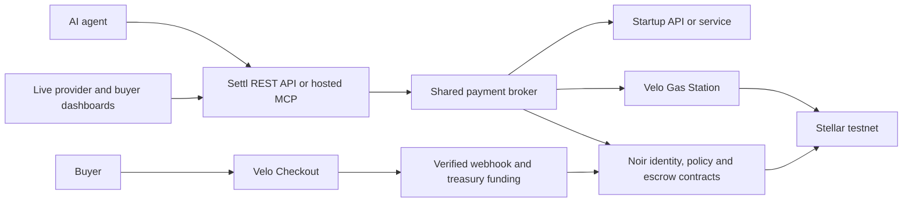

# Settl.ai

An API and MCP payment gateway that lets startups charge AI agents for API and service usage, with automated payments through Noir and Velo on Stellar testnet.

Startups register priced services. Buyers fund their agents' budgets and set spending rules. Agents discover and call those services through Settl's REST API or hosted MCP server; Settl checks policy, coordinates payment, and returns the result with a receipt.

**Development status, November 5, 2026:** the protocol helpers, verifier, pure backend rules, chain adapter, and demo UI are implemented locally. The public API, hosted MCP, and complete payment flow are still to be built. The November 5 check passed 95 offline tests, typecheck, lint, and build using Node 24.22.1. Live testnet verification remains pending. See the [progress report](docs/progress.md).

## Who uses Settl

| Participant | Role |
|---|---|
| Startup / provider | Registers an API or service, sets its price and payment mode, serves requests, and claims earnings. |
| Buyer | Funds an agent's prepaid budget and controls caps, allowed providers, expiry, and approvals. |
| AI agent | Chooses services and requests calls through REST or MCP within the buyer's rules. |
| Settl | Coordinates quotes, policy checks, provider calls, payment authorization, verification, receipts, and automations. |

The gateway API and MCP are the core product. Provider and buyer dashboards, approval screens, and the stage view are also required to work with live data for the November 8 demo.

## How it works

The following is the target architecture. The public gateway, hosted MCP, broker, persistence, and provider integration are planned components.



**Noir** supplies the device registry, agent policy registry, and payment escrow. **Velo** supplies checkout for top-ups and fee sponsorship for eligible transactions. Settl connects these services to startup APIs and agent clients.

### Payment modes

- **Per-call:** obtain a quote, check policy, authorize payment on-chain, then call the provider with transaction proof and return the result and receipt.
- **Settl on Result:** reserve the quoted amount off-chain, call the provider, verify the result against agreed checks, and authorize payment only on a pass. Failed checks release the reservation without a charge.

An authorization moves value from the device's available escrow to the provider's pending balance. The provider receives it in its wallet through a separate `claim`, manually or through the planned auto-claim automation.

The demo uses native testnet XLM, displayed in pesos at a configured demo rate. Wallets are custodial for the testnet MVP. Live or production payment support is not established by the offline tests.

## Planned integration interfaces

These interfaces describe the intended integration and are **not implemented endpoints yet**.

| Interface | Purpose |
|---|---|
| `POST /api/agent/call` | Run a paid service call through the shared broker. |
| `POST /api/provider/payments/verify` | Verify payment evidence before a provider serves a paid request. |
| `POST /api/provider/results` | Submit a result for outcome verification. |
| `/mcp` | Hosted MCP transport for authenticated agents. |
| `POST /api/velo/webhook` | Verify Velo payment notifications and coordinate escrow funding. |
| Provider SDK | Issue 402 quotes and connect provider handlers to verification and result settlement. |

The six planned MCP tools are:

| Tool | Purpose |
|---|---|
| `settl_list_services` | Discover available services. |
| `settl_get_budget` | Read balance, policy limits, daily budget remaining, and approvals. |
| `settl_quote` | Obtain a service's payment terms. |
| `settl_call` | Request a service call and receive its result and payment status. |
| `settl_check_approval` | Check a requested spend approval. |
| `settl_receipts` | Retrieve recent receipts. |

See the [current API/MCP design](docs/superpowers/specs/2026-11-04-settl-api-mcp-design.md) for the contract and authentication model.

## Run locally

Use **npm workspaces only**, from the repository root. Node **24.22.1** is the previously verified runtime; Noir SDK 0.3.0 requires `^22.23.4 || ^24.22.1 || >=26.12.1`.

```sh
npm install
npm run dev
```

Open [localhost:3000](http://localhost:3000). At `/login`, select the provider or buyer workspace; any password works for the current demo sign-in. The screens currently use demo data and do not execute real gateway payments.

For local service configuration, copy `.env.example` to `apps/web/.env.local` **only if the local file does not already exist**, then fill the required fields. Preserve existing values and never commit credentials.

| Configuration | Needed for |
|---|---|
| Stellar RPC, passphrase, and Noir contract IDs | Chain adapter; template values target testnet. |
| `VELO_GAS_API_KEY` | Live Gas Station sponsorship; separate from the general API key. |
| `VELO_API_KEY` | Live checkout routing checks and planned checkout integration. |
| `VELO_WEBHOOK_SECRET` | Planned Velo webhook verification. |
| `DATABASE_URL`, `WALLET_ENC_KEY`, `SETTL_TREASURY_SECRET` | Planned persistence, encrypted wallet custody, and treasury funding. |

No credentials are needed for the offline test suite. The opt-in chain suite requires both Velo keys before network writes; `DATABASE_URL` is not required for that suite.

```sh
npm test && npm run typecheck && npm run lint && npm run build
```

Run the live suite separately, only after the two Velo keys are configured:

```sh
npm run test:testnet -w @settl/stellar
```

The live suite is not part of `npm test`. It creates Friendbot-funded test accounts and attempts real contract operations. Its checkout spike records routing details; completing hosted checkout and confirming settlement is a separate live check. See [chain adapter usage](packages/stellar/README.md) and [spike evidence](docs/spikes.md).

## Repository

| Location | Current contents |
|---|---|
| `apps/web` | Next.js 16 demo screens and pure backend rules; planned host for API/MCP and live dashboards. |
| `packages/core` | Quote, payment header, and receipt schemas; encoding and amount helpers. |
| `packages/verifier` | Deterministic receipt checks. |
| `packages/stellar` | Noir/Stellar adapter, Velo sponsorship, relayer fallback, reconciliation, and transaction decoding. |
| `docs` | Product designs, implementation plan, progress, and spike findings. |

## November 8 live demo

The submission deadline is **Sunday, November 8, 2026, at 8:00 AM Manila time**. The full demo scope includes:

- REST and MCP access to the shared broker, provider integration, and a demo AI agent.
- Paid service usage, a failing result with no charge, an on-chain cap rejection, and human spend approval.
- Velo top-ups, provider claims, outbound webhooks, auto-claim, and low-budget alerts.
- Provider and buyer dashboards and stage view connected to live data, with the planned scripted stage fallback retained.

These are delivery goals, not a claim that the complete demo already works. The existing step-1 gate remains a real `authorize` confirmed on testnet before advancing to the next implementation step.

## Documentation

- [Progress report](docs/progress.md): what is implemented, verified, blocked, and still to build.
- [Handoff](HANDOFF.md): continuation instructions, ordered next steps, and gotchas.
- [API, MCP, and automations design](docs/superpowers/specs/2026-11-04-settl-api-mcp-design.md): current backend design; takes precedence over older backend descriptions.
- [Product design](docs/superpowers/specs/2026-11-03-settl-design.md): product context, demo script, and limitations; read with the newer backend design and plan revisions.
- [Implementation plan](docs/superpowers/plans/2026-11-03-settl.md): build sequence and decision revisions; its top revision notes override historical entries.
- [UI design](docs/superpowers/specs/2026-11-03-settl-ui-design.md): flows and visual system.
- [Spike findings](docs/spikes.md): compatibility evidence and outstanding live checks.
- [Web app guide](apps/web/README.md) and [chain adapter guide](packages/stellar/README.md): workspace-specific instructions.
