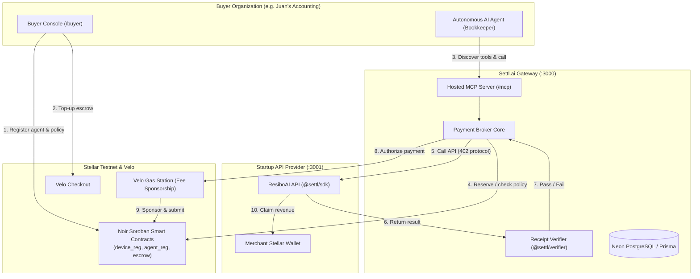

# Settl.ai: Live System & Demonstration Guide

> **Current runbook:** use [Provider-to-Codex Live Demo](CODEX_MCP_LIVE_DEMO.md) for the user-confirmed external CLI-agent flow and the exact values for both website forms. The historical guide below contains outdated SDK/MCP examples and contract addresses; do not use it as the current setup reference. Its deterministic runner is a separate rehearsal utility.

> **Zero Mockups. 100% Real Stellar Testnet, Soroban Contracts, Velo Gas Relayer, & MCP Gateway.**
> 
> This document details how the complete Settl.ai platform works live in practice — from a startup setting up their API, to a buyer provisioning an AI agent with on-chain guardrails, running the agent via MCP, paying usage fees on Stellar testnet, and claiming merchant earnings. The November 7 revision makes mock OCR per-call; historical outcome transaction evidence below predates this change.

---

## 1. System Architecture



---

## 2. Step 1: Startup Onboarding (API Provider Setup)

### 2.1 Integrating Settl in the Startup's Code (5 Lines of Code)
A startup like **ResiboAI** embeds the `@settl/sdk` middleware into their Express, Next.js, or Fastify app:

```typescript
import express from "express";
import { settlOutcomeMiddleware } from "@settl/sdk";

const app = express();
app.use(express.json());

// 5-line Settl integration: Pay-on-Result receipt OCR
app.post("/parse-receipt", 
  settlOutcomeMiddleware({
    serviceId: "resibo_parse",
    providerId: "resibo",
    criteriaPreset: "resibo.receipt.v1",
    settlUrl: process.env.SETTL_API_URL ?? "http://localhost:3000",
    providerKey: process.env.SETTL_PROVIDER_KEY,
  }),
  async (req, res) => {
    // Startup's core logic: only runs when quote is locked
    const result = await ocrEngine.parse(req.body.image);
    // The SDK verifies the payment proof before this mock handler runs.
    res.json(result);
  }
);

app.listen(3001);
```

### 2.2 Registering the Endpoint on the Dashboard
1. Log in to Settl at `http://localhost:3000/login` as **ResiboAI** (`mara@example.com`).
2. Navigate to **Endpoints** (`http://localhost:3000/provider/endpoints`).
3. Click **Add Endpoint**:
   - **Service Name**: `resibo_parse`
   - **Endpoint URL**: `http://localhost:3001/parse-receipt` *(must match allowed origin)*
   - **Pricing Mode**: `per_call` for the mock demo. `outcome` remains an optional product mode.
   - **Display Price**: `PHP 2.00` *(translates to native XLM stroops on-chain)*
   - **Outcome Criteria**: unset for per-call billing; `resibo.receipt.v1` applies only to an explicitly selected outcome product.
4. Save: The endpoint is immediately indexed in Settl's hosted MCP server and available for agents to discover.

---

## 3. Step 2: Buyer Onboarding & Agent Guardrails

### 3.1 Creating an AI Agent with On-Chain Limits
1. Switch to the Buyer account at `http://localhost:3000/login` as **Juan's Accounting** (`juan@example.com`).
2. Go to **Agents** and click **New Agent** (`http://localhost:3000/buyer/agents/new`).
3. Set the operational guardrails:
   - **Agent Name**: `Bookkeeper`
   - **Allowed Providers**: `resibo`, `geoph`
   - **Max Price per Call**: `PHP 10.00` (Hard spend limit per invocation)
   - **Auto-Approve Threshold**: `PHP 5.00` (Calls above this generate a human approval ticket)
   - **Daily Budget Limit**: `PHP 50.00` (UTC daily cumulative spend ceiling)
4. Submit:
   - A custodial Stellar keypair is generated and encrypted at rest with AES-256-GCM (`WALLET_ENC_KEY`).
   - The agent's identity is registered in the Soroban `device_registry` smart contract.
   - The spending policy is registered in the Soroban `agent_registry` contract.
   - A single-use API Key (`stl_agent_...`) is generated and shown once to the buyer.

### 3.2 Funding the Agent's Prepaid Escrow
- **Via Velo Checkout**: Clicking **Top-up** creates a Velo checkout session. Once paid, a signed webhook arrives at `/api/velo/webhook`, triggering `payment_escrow.fund_escrow`.
- **Pre-Funded Seed**: The live demo agent `bookkeeper` is pre-funded on Stellar testnet with native XLM escrow.

---

## 4. Step 3: Agent Tool Discovery & MCP Calling

The AI agent interacts with Settl exclusively through standard **Model Context Protocol (MCP)** or REST:

### Connecting to Settl Hosted MCP
```typescript
import { Client } from "@modelcontextprotocol/sdk/client/index.js";
import { SSEClientTransport } from "@modelcontextprotocol/sdk/client/sse.js";

const transport = new SSEClientTransport(
  new URL("http://localhost:3000/mcp"),
  {
    headers: {
      Authorization: `Bearer ${process.env.DEMO_AGENT_API_KEY}`
    }
  }
);
const client = new Client({ name: "bookkeeper-agent", version: "1.0.0" });
await client.connect(transport);
```

### Available Live MCP Tools
| MCP Tool | Purpose | Real Action |
|---|---|---|
| `settl_list_services` | Discover registered paid tools | Queries database for active endpoints and live pricing |
| `settl_get_budget` | Read live budget & escrow balance | Queries Soroban `payment_escrow.balance_of` on Stellar testnet |
| `settl_call` | Invoke a paid provider endpoint | Orchestrates 402 quote, verification, and on-chain settlement |
| `settl_check_approval` | Check status of human approval | Queries database for manager decision on flagged tickets |
| `settl_receipts` | Retrieve cryptographic receipts | Reads signed transaction hashes and verifier check logs |

---

## 5. Step 4: Live Payment Execution & Verification

### Scenario A: Usage billing (clean mock OCR)
```
[Agent] calls settl_call("resibo_parse", { fixture: "clean" }, maxPrice: "10.00")
  ├── 1. Broker verifies Juan's policy: PHP 2.00 <= PHP 5.00 auto-approve -> PASSED
  ├── 2. Broker persists a pending payment before submitting 1,333,334 stroops (PHP 2.00)
  ├── 3. Noir authorize confirms on Stellar testnet; a real paid receipt is recorded
  ├── 4. Broker sends transaction proof to the mock Resibo provider
  ├── 5. Provider SDK verifies proof and returns the clean fixture (no OCR model)
  └── 6. This run's actual transaction hash and the reduced escrow balance are shown
```

### Scenario B: Usage billing (blurry mock receipt — PHP 2 charged)
```
[Agent] calls settl_call("resibo_parse", { fixture: "blurry" }, maxPrice: "10.00")
  ├── 1. Broker enforces policy and authorizes the same PHP 2 usage fee
  ├── 2. Resibo returns its low-confidence fixture (confidence: 0.42)
  ├── 3. Result quality does not reverse the confirmed per-call payment
  └── 4. Status: `paid`; escrow decreases and daily spend increases by 1,333,334 stroops
```

Apply the [scoped existing-database update](../apps/web/prisma/README.md#existing-mock-ocr-billing) before this revised rehearsal. Outcome mode and its failed-check zero-charge behavior remain supported for products explicitly configured that way. A provider failure after per-call settlement retains the paid receipt with a provider error. Never retry a pending or unknown transaction.

### Scenario C: Caller Price Cap Protection ($0 Spent)
```
[Agent] calls settl_call("resibo_pro", maxPrice: "10.00")
  ├── 1. Resibo Pro quotes PHP 15.00
  ├── 2. Settl client checks caller policy: PHP 15.00 > PHP 10.00 maxPrice
  ├── 3. Call is halted locally before network request: `over_max_price`
  └── 4. Zero payment gas or fees spent
```

### Scenario D: Human-in-the-Loop Spend Approval
```
[Agent] calls settl_call("geoph_lookup", { city: "Makati" }, maxPrice: "10.00")
  ├── 1. GeoPH quotes PHP 8.00 (within PHP 10.00 cap, but > PHP 5.00 auto-approve)
  ├── 2. Settl halts execution and generates Approval Ticket: `cmw503tbi000zvktnimhymzar`
  ├── 3. Status returns `approval_required` with URL:
  │      http://localhost:3000/buyer/approvals/cmw503tbi000zvktnimhymzar
  ├── 4. Human manager reviews on dashboard and clicks "Approve" (POST /api/approvals/[id]/resolve)
  ├── 5. Agent polls `settl_check_approval`, detects `approved`, and resumes call with `approvalId`
  └── 6. Real Soroban payment settles on Stellar testnet:
         Tx Hash: fccf77cf9c7423f41274e6abb765db05f684d66178683ea752d91f15a7f4354b
```

---

## 6. Step 5: Provider Payouts & Claims

When payments settle, funds move from the Buyer's escrow into the Provider's pending balance in the `payment_escrow` Soroban contract.

1. Log in as **ResiboAI** (`mara@example.com`).
2. Navigate to **Earnings** (`http://localhost:3000/provider/earnings`).
3. View real accrued earnings breakdown by service and quote.
4. Click **Claim Earnings**:
   - Triggers `payment_escrow.claim(token, merchant_wallet)`.
   - Velo Gas Station sponsors the transaction fee.
   - Native XLM transfers directly to the startup's on-chain Stellar wallet.

---

## 7. How to Run the Live Demo

### Option A: The 1-Terminal Demo Orchestrator (Recommended)
You do not need to juggle multiple terminal tabs. A single Python orchestrator manages Next.js (`:3000`), the Resibo Express server (`:3001`), and the live MCP driver:

```bash
# Interactive mode (pauses between steps; supports terminal or web human approval):
npm run demo

# Fast mode (continuous execution with automatic approval resolution):
npm run demo:fast
```

### Option B: Running Services Manually in Separate Terminals
If you prefer running each service independently:

1. **Terminal 1 — Next.js Web App & Hosted MCP**:
   ```bash
   npm run dev
   # Runs on http://localhost:3000
   ```

2. **Terminal 2 — Resibo AI Express Provider**:
   ```bash
   cd apps/resibo
   PORT=3001 SETTL_API_URL=http://localhost:3000 SETTL_PROVIDER_KEY=stl_prov_demo_shared_secret_2026 npx tsx src/server.ts
   # Runs on http://localhost:3001
   ```

3. **Terminal 3 — Live Demonstration Driver**:
   ```bash
   # Reset stale journal and execute live testnet flow:
   npx tsx scripts/demo-e2e.ts --reset
   ```

---

## 8. Live Testnet Evidence Links

All smart contract interactions can be inspected live on the **Stellar Expert Testnet Explorer**:

- **Payment Escrow Contract**: [`CA5S4S7QGHJHJWVJBYL3CXZXZTNGKXMNZVDAEQNN7NUXFP4D7BYK7HIX`](https://stellar.expert/explorer/testnet/contract/CA5S4S7QGHJHJWVJBYL3CXZXZTNGKXMNZVDAEQNN7NUXFP4D7BYK7HIX)
- **Agent Registry Contract**: [`CBTDMJVCFQDIVWZBKAKZ2FQ3UEJNAAUFYCTJ3E4ON2MYXPLPSIXQ25JZ`](https://stellar.expert/explorer/testnet/contract/CBTDMJVCFQDIVWZBKAKZ2FQ3UEJNAAUFYCTJ3E4ON2MYXPLPSIXQ25JZ)
- **Device Registry Contract**: [`CB4DPMGOA374JIB2ZVD4AHW5GJKQUYNOFGRYNOJ75EFH2KCJSMHOWIRA`](https://stellar.expert/explorer/testnet/contract/CB4DPMGOA374JIB2ZVD4AHW5GJKQUYNOFGRYNOJ75EFH2KCJSMHOWIRA)
- **Live Settl on Result Settlement Tx**: [`322aa0492992ea4dac0fdd369f1bba761ee7284a0f0bcefd67bf0a9c4e0869c0`](https://stellar.expert/explorer/testnet/tx/322aa0492992ea4dac0fdd369f1bba761ee7284a0f0bcefd67bf0a9c4e0869c0)
- **Live Human Approval Settlement Tx**: [`fccf77cf9c7423f41274e6abb765db05f684d66178683ea752d91f15a7f4354b`](https://stellar.expert/explorer/testnet/tx/fccf77cf9c7423f41274e6abb765db05f684d66178683ea752d91f15a7f4354b)
