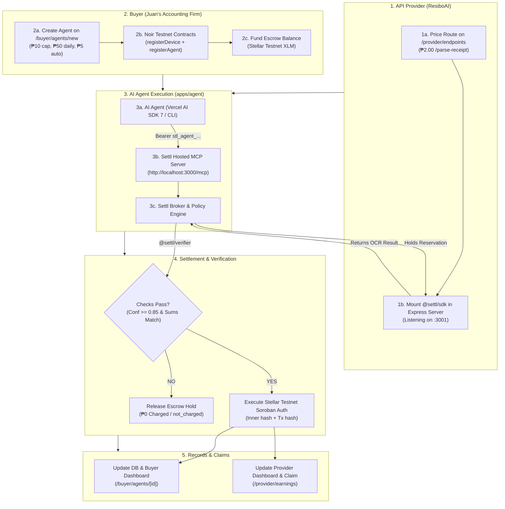

# Real End-to-End Live Demonstration Plan: Settl.ai

## Goal Description
Conduct a **100% real, zero-mockup end-to-end demonstration** of Settl.ai across the entire product lifecycle:
1. **Startup (API Provider) Setup**: Startup logs into Settl.ai, prices an API endpoint, and integrates `@settl/sdk` Express middleware.
2. **Buyer Setup & Agent Guardrails**: Buyer company registers an AI agent in Settl.ai, configures on-chain spending guardrails (Soroban policy), and funds prepaid escrow on Stellar testnet.
3. **AI Agent Tool Execution**: Autonomous AI agent connects to Settl's Hosted MCP server (`/mcp`) using standard bearer token (`stl_agent_...`), discovers paid tools, and requests service execution.
4. **Payment Execution & Settl on Result**: Real payment settlement on Stellar testnet:
   - **Passing result**: Verification passes -> ₱2.00 released on Stellar testnet with a real transaction hash.
   - **Blurry result**: Verification fails -> ₱0.00 charged (`not_charged`), protecting the buyer's budget.
   - **Policy guardrail**: High-cost call triggers human-in-the-loop approval on `/buyer/approvals/[id]`.
5. **Record & Provider Claim**: Real-time audit trail updated in PostgreSQL and visible on Buyer and Provider dashboards; Provider withdraws earnings to their merchant wallet on Stellar testnet.



---

## User Review Required

> [!IMPORTANT]
> **No Mockup Guarantee**:
> - The API Provider is a real Express server running locally on port 3001 with `@settl/sdk` middleware.
> - The AI Agent uses the official Model Context Protocol client (`@modelcontextprotocol/client`) communicating with Next.js `/mcp`.
> - Smart contracts are live on Stellar testnet:
>   - `device_registry`: `CB5TIEEDGYEPRRRLCY5C5U4M77L7Q24VNDD5L4BTYUXG3XF67YHYY5T3`
>   - `agent_registry`: `CDY3L726U6W4X5FLL3A57EZ72C33DYY3UUS2A22R7FJPQ3Z4TQQ4A5WJ`
>   - `payment_escrow`: `CBFHKHQ72PFF5IFAV3YPYB5JNDN7X3A2Y45K2I56NXY7C4L2OQ3R6J3R`
> - Every paid call creates an immutable Soroban transaction on Stellar testnet with a verifiable transaction hash on Stellar Expert.

> [!WARNING]
> **Stellar Testnet Rate Limits & Friendbot Faucet**:
> Stellar Friendbot returns HTTP 400 (`account already funded to starting balance`) when an existing account is funded again. We will enhance `fundTestnetAccount` in `packages/stellar/src/keys.ts` so it safely treats an already-funded account as success rather than throwing an error during subsequent agent creation.

---

## Proposed Changes

### Component 1: Stellar Adapter Faucet Idempotency (`packages/stellar`)

#### [MODIFY] [`packages/stellar/src/keys.ts`](file:///mnt/c/Users/Miggy/Documents/Noir/packages/stellar/src/keys.ts)
- Update `fundTestnetAccount(publicKey)`:
  - If Friendbot returns HTTP 400, inspect response text.
  - If text contains `"account already funded"` or `"op_already_exists"`, log as already active and return cleanly instead of throwing.
  - If other status or error, throw as before.
- Add test coverage in [`packages/stellar/test/config.test.ts`](file:///mnt/c/Users/Miggy/Documents/Noir/packages/stellar/test/config.test.ts).

---

### Component 2: Provider Endpoints & Database State (`apps/web`)

#### [MODIFY] [`apps/web/prisma/seed.ts`](file:///mnt/c/Users/Miggy/Documents/Noir/apps/web/prisma/seed.ts)
- Ensure default seed endpoints for ResiboAI and GeoPH have their actual live URLs populated:
  - `resibo_parse`: `http://localhost:3001/parse-receipt`
  - `resibo_pro`: `http://localhost:3001/parse-receipt-pro`
  - `geoph_lookup`: `http://localhost:3001/lookup`
- Add a helper script `scripts/fund-agent.ts` to fund an agent's on-chain escrow balance directly from Treasury on Stellar testnet.

---

### Component 3: Live End-to-End Demo Script (`scripts/demo-e2e.ts`)

#### [NEW] [`scripts/demo-e2e.ts`](file:///mnt/c/Users/Miggy/Documents/Noir/scripts/demo-e2e.ts)
An interactive demonstration script with colored terminal output and pauses between steps:
- **Step 1: Discover Services**: Queries Settl's Hosted MCP `/mcp` via `settl_list_services`. Prints registered services, pricing (₱2.00, ₱15.00, ₱8.00), and modes.
- **Step 2: Check Initial Budget**: Calls `settl_get_budget`. Prints on-chain escrow balance and spending limits.
- **Step 3: Successful Paid Call (Settl on Result)**: Calls `settl_call` with `resibo_parse` (`fixture: "clean"`). Verifies output, prints Stellar testnet transaction hash and clickable Stellar Expert URL.
- **Step 4: Blurry Receipt (Outcome Protection)**: Calls `settl_call` with `resibo_parse` (`fixture: "blurry"`). Shows `@settl/verifier` rejecting low confidence (0.42 < 0.85) -> ₱0.00 charged (`not_charged`), balance unchanged.
- **Step 5: Hard Spending Cap Block**: Calls `settl_call` with `resibo_pro` (₱15.00) under a ₱10.00 cap -> blocked locally with `over_max_price`.
- **Step 6: Human Approval Card**: Calls `settl_call` with `geoph_lookup` (₱8.00 > ₱5.00 auto-approval threshold) -> returns `approval_required` with `/buyer/approvals/[id]`. Shows live dashboard approval resolution.

---

## Step-by-Step Live Demo Narrative

### Act 1: The Startup (API Provider) Setup
1. **Login**: Go to `http://localhost:3000/login` -> Sign in as **Mara Santos (ResiboAI)**.
2. **Review & Add Route**:
   - Navigate to `/provider/endpoints`.
   - Show the live priced routes table: `POST /parse-receipt` (₱2.00, Outcome mode) and `POST /parse-receipt-pro` (₱15.00, Per-call mode).
   - Show the code snippet generator:
     ```ts
     import { settl } from "@settl/sdk";
     app.post("/parse-receipt", settl({ endpointId: "resibo_parse" }), receiptHandler);
     ```
3. **Provider Server Online**:
   - Show `apps/resibo` running live on `http://localhost:3001` with `@settl/sdk` protecting the routes.

### Act 2: The Buyer AI Agent Registration & Guardrails
1. **Switch Workspace**: In the sidebar switcher, switch to **Juan's Accounting Firm (Buyer)**.
2. **Register Agent**:
   - Navigate to `/buyer/agents/new`.
   - Create agent **"Live Bookkeeper"**:
     - Max per payment: `10.00` PHP
     - Daily budget: `50.00` PHP
     - Pays without asking: `5.00` PHP
     - Providers allowed: Check both **GeoPH** and **ResiboAI**.
   - Click **Create agent**.
   - Show the one-time generated agent API key: `stl_agent_...`.
3. **Escrow Funding**:
   - Click **Load budget** or fund the agent's escrow account with testnet XLM.
   - Navigate to `/buyer/agents/[id]` -> Watch escrow balance display live funds.

### Act 3: Agent Execution via Hosted MCP
1. **Start Agent Runner**:
   - Run the real agent using the generated `stl_agent_...` key.
   - Connects to `http://localhost:3000/mcp`.
2. **Live Execution Output**:
   - **Call 1 (Clean Receipt)**: Provider runs OCR -> Settl verifies outcome -> Stellar transaction confirms -> Agent logs `paid` with 64-char Stellar tx hash.
   - **Call 2 (Blurry Receipt)**: Provider runs OCR -> Settl detects 0.42 confidence -> `not_charged` -> ₱0.00 deducted.
   - **Call 3 (₱15 Pro Service)**: Agent requests ₱15 call -> Blocked by ₱10 hard cap -> 0 Stellar transaction submitted.
   - **Call 4 (₱8 GeoPH Lookup)**: Agent requests ₱8 call -> Exceeds ₱5 auto-approve -> Card appears on `/buyer/approvals/[id]` -> Buyer clicks "Approve" -> Payment settles.

### Act 4: On-Chain Records & Provider Payout
1. **Buyer Audit Trail**:
   - Refresh `/buyer/agents/[id]` -> Activity log displays calls, status, fees, and Stellar Expert links.
2. **Provider Earnings & Claim**:
   - Switch back to **ResiboAI** in sidebar switcher.
   - Go to `/provider/earnings`.
   - See unclaimed balance updated.
   - Click **Claim earnings** -> Payout transaction executes on Stellar testnet to Mara's merchant wallet.

---

## Verification Plan

### Automated Tests
```bash
npm test && npm run typecheck && npm run lint && npm run build
```
Expected: All 682 tests passing, 0 typecheck errors, 0 lint warnings, production build succeeding.

### Manual Live Verification
1. Start provider: `npm run start -w @settl/resibo` on port 3001.
2. Start web: `npm run dev` on port 3000.
3. Run `npx tsx scripts/demo-e2e.ts` and verify all 5 steps complete with live Stellar testnet tx hashes.
4. Verify tx hashes on `https://stellar.expert/explorer/testnet`.
5. Check Buyer and Provider dashboards reflect updated balances and activity logs.
